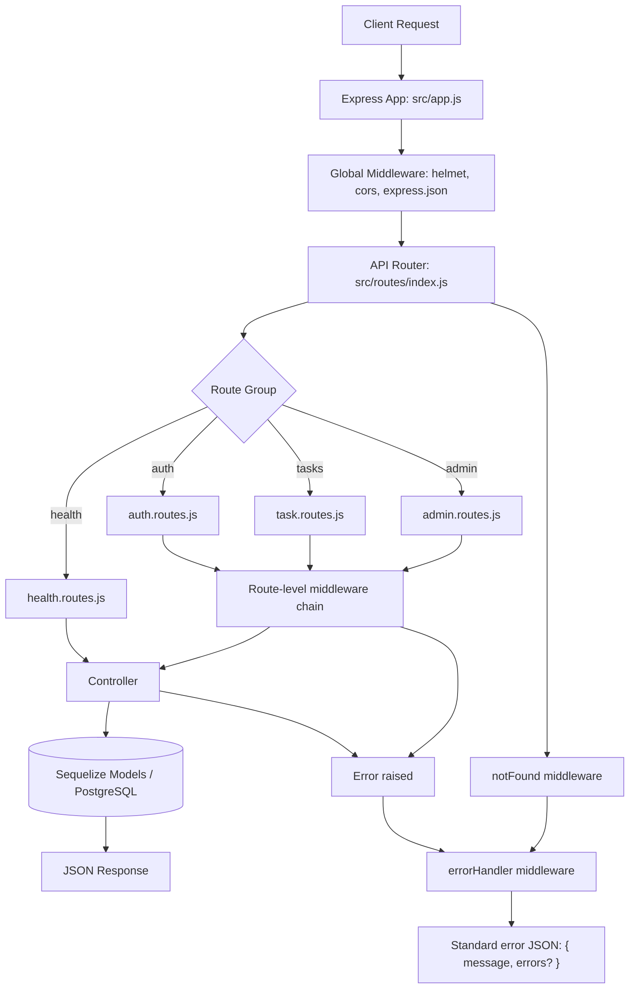

# Server Architecture: Request/Response Processing

This document outlines how the backend processes incoming HTTP requests and builds responses.

## High-level flow



## Route-level middleware order

Routes apply middleware in a strict order before controller logic:

1. **Security/auth checks** (for protected routes)  
   - `requireAuth` (Bearer token required)  
   - `requireRole('admin')` (admin routes)
2. **Rate limiting** (auth endpoints)  
   - `authLimiter`
3. **Input validation**  
   - `validate(...)` with `express-validator` rules
4. **Database availability gate**  
   - `requireDatabase` (returns `503` if DB is disconnected)
5. **Controller handler**  
   - wrapped by `asyncHandler(...)` so thrown async errors go to `errorHandler`

## Response behavior

- **Success**: controllers return JSON (or `204` for successful deletes).
- **Validation or domain errors**: unified error format from `ApiError`.
- **Unhandled/server errors**: normalized by `errorHandler` into:
  ```json
  { "message": "...", "errors": { "field": "message" } }
  ```
  (`errors` appears when field-level details exist).
- **Unknown route**: `notFound` creates a `404` error for `errorHandler`.

## Startup lifecycle (server boot)

`src/server.js` starts the app with this sequence:

1. Authenticate Sequelize connection.
2. Run `sequelize.sync()`.
3. Mark DB connection state.
4. Start HTTP listener on configured `PORT`.
5. If port is already in use (`EADDRINUSE`), log and exit.

## Recent testing updates

- `server/tests/auth.test.js` is now fully implemented for the B-card checklist:
  - password hashing on registration
  - validation/field error behavior
  - duplicate account conflicts (`409`)
  - login by username or email
  - expired token handling (`401`)
  - auth rate limiting (`429`)
  - profile and password update flows
- `server/package.json` now runs the auth suite by default:
  - `"test": "mocha tests/auth.test.js"`

### Test commands

- Run the server default test script (auth-focused):
  - `npm test -w server`
- Run a specific test file directly:
  - `npm test -w server -- tests/auth.test.js`
